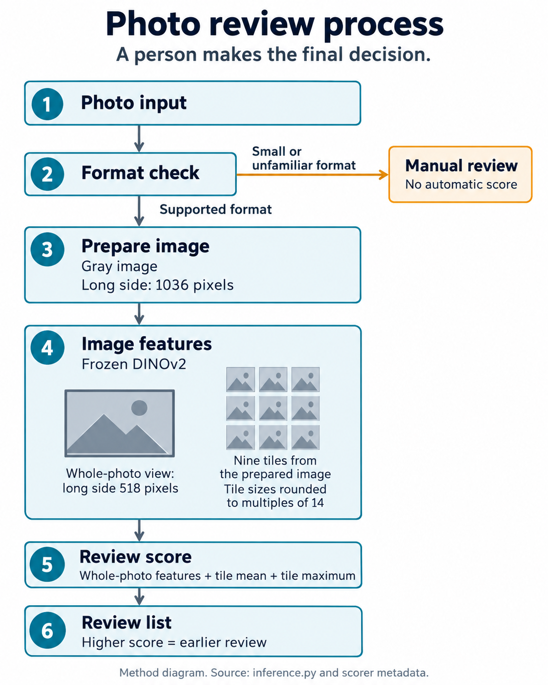
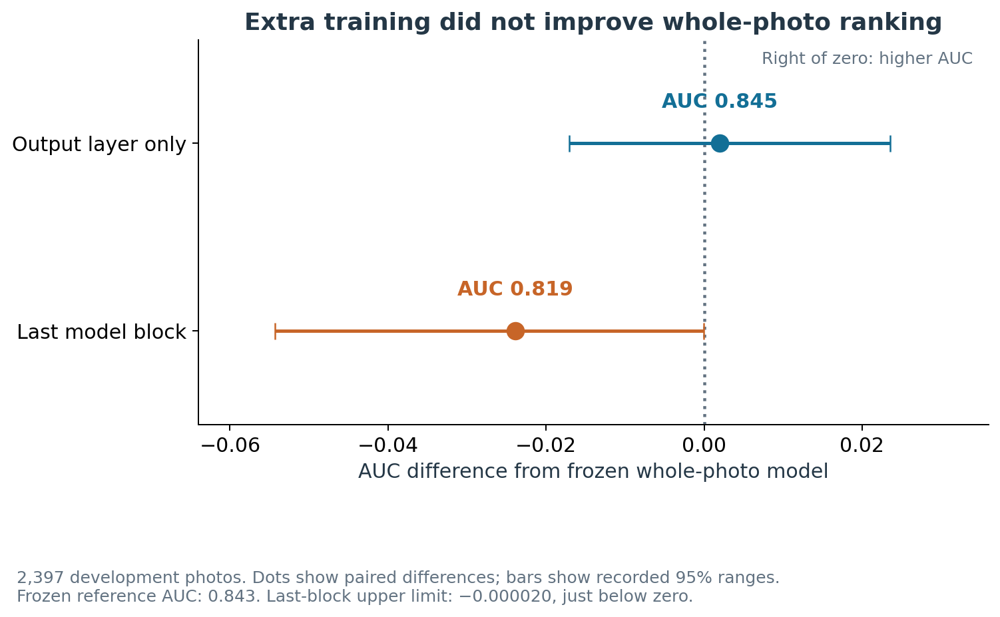
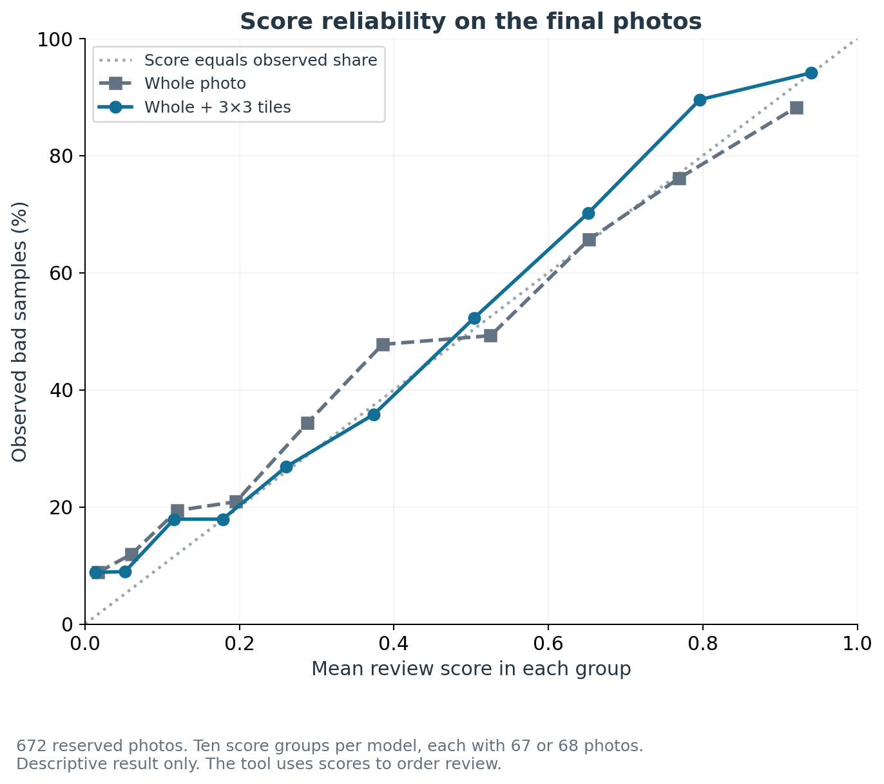

## Category Declaration

**Model & Algorithm**

**Project:** AI4S: Chip Photo Review with Local Image Tiles

**Draft updated:** 10 October 2026. **Evidence cutoff:** 8 October 2026.

**Team details:** Member names, roles and team leader remain to be confirmed.

## Demo Video

**Video created:** The recorded demonstration is 4 minutes 34 seconds long. It has 1080p video, synthetic narration and English subtitles. The file is `Video/AI4S_Demo.mp4` and is approximately 6.5 MB.

**Attachment and public link pending:** Browser approval blocked the Kaggle upload. The video must be attached or linked before submission and accessible without login or payment.

## Code Repository Link

**Pending:** The GitHub repository link will be added by the project owner before submission. The working local entry point is `code/inference.py`. The package contains a saved scorer, installation requirements, experiment scripts and test records. Public access and the final package still require a check.

## Project Summary

Researchers must inspect microscope photos before they use organ-on-a-chip samples in more work. This project examines a review aid that places likely poor-quality samples first. A person makes the final decision.

The primary method combines a whole-photo view with nine smaller image tiles. It uses an existing DINOv2 image model without more training. A small trained model calculates the review score. We chose the method with development data, then evaluated the fixed choice on reserved photos. Unsupported image formats go to manual review without a score.

On 672 automatically scored final photos, the method gave a ranking score of 0.850. The whole-photo reference gave 0.810 in the same clean rebuild. The paired gain was 0.040, with a 95% range from 0.015 to 0.067. This score measures ranking quality. It does not mean 85% accuracy.

Separate studies examined nucleus analysis and droplet control. On 50 final nucleus images, learned counting reduced average count error from 4.93 to 4.31 nuclei. A model trained to identify nucleus edges improved the outline score from 0.855 to 0.901. The count and outline results use different settings.

After evaluation repairs, learned droplet control reduced mean size error in harder simulated conditions. We did not do a test on a physical chip. The report also records failed methods, weak groups and incomplete work. A fresh Kaggle installation ran the photo demonstration. We have not measured human time savings or performance in an independent chip laboratory.

## Technical Report

### 1. Problem and intended use

An organ-on-a-chip is a small device that supports living cells under controlled conditions. Our primary input is a microscope photo of a chip sample. The target label is an expert rating of good or bad sample quality. It is not a separate label for blur, exposure, cell death or drug response.

The tool produces a review list and an optional sheet of example photos. A higher score means earlier review. The intended user is a researcher who decides which samples require closer inspection.

We examined one practical question: **Does local image detail improve the order of sample review?** We also studied two related questions. Can small learned models improve nucleus measurements? Can learned control improve a defined droplet simulator?

These are separate studies. The delivered photo tool does not operate a physical chip or give a combined laboratory system.



*Figure 1. Photo-review process. The amber branch sends small or unfamiliar formats to manual review without a score. The model names, dimensions and processing steps match the code. This diagram is not an experiment result.*

### 2. Data and evaluation

#### 2.1 Data sources

| Source | Role in this project | Evaluation scope | Source and usage record |
|---|---|---|---|
| Organ-on-a-Chip Image Dataset | Primary sample-quality task | 3,072 photos: 2,397 development and 675 reserved final photos | [Movčana and colleagues, Zenodo 10203721](https://zenodo.org/records/10203721). Record: CC BY 4.0. The paper states CC BY-SA; this difference remains open. |
| BBBC039 | Nucleus counting and outlines | 200 images: 150 development and 50 final images | [Broad Bioimage Benchmark Collection](https://bbbc.broadinstitute.org/BBBC039), CC0. |
| BBBC038 | Outside nucleus test | 670 source images; 43 shared images excluded. Remaining test: 519 gray and 108 color images | [BBBC038](https://bbbc.broadinstitute.org/BBBC038), CC0. |
| RxRx1 | C01 batch-transfer study | Comparison of features across laboratory batches | [RxRx1](https://www.rxrx.ai/rxrx1). Research record only; exact publication scope remains to be settled. |
| JUMP Cell Painting profiles | C02 batch-correction study | Matched development comparisons on stored profiles | [Cell Painting Gallery](https://registry.opendata.aws/cellpainting-gallery/), CC0 1.0 for gallery data. |
| Allen Cell DIC and lamin B1 images | C03 image-translation study | Input-only depth choice; direct and translated measurement routes | [Allen Cell](https://www.allencell.org/). Research and non-commercial terms are recorded; redistribution is not cleared. |
| Droplet model equations | R01-R04 simulation studies | Practice simulator with declared response assumptions | [Pärnamets et al., 2022](https://doi.org/10.1109/ACCESS.2022.3226623). This project did not collect physical control data. |

The chip dataset has six recorded cell types. Its full labels contain 1,727 good and 1,345 bad samples. The original published train, validation and test counts are 2,130, 286 and 656. Our experiments use the separate, saved group split described above.

We did checks of file integrity, image decoding and duplicate overlap. Filename prefixes give clues about related acquisition groups. They are not verified physical chip identifiers. The dataset has no explicit chip or donor identifier that resolves this limit.

#### 2.2 Test design

We kept whole filename groups together in the five development folds. Each fold is a separate training and validation division. Inner divisions selected the scorer and image-processing settings using training data only.

The final chip set contains 675 photos. The format check routes three portrait photos to manual review. The headline comparison uses the same 672 remaining photos for the two methods. This set contains 284 bad samples, 388 good samples and 13 filename groups.

The harder A03 test removes a cell type and all its related filename groups from training. An earlier test removed the cell type alone. It left shared groups in 1,813 of 2,397 evaluated photos. We withdrew its claim of no loss on unseen cell types.

The nucleus development tests keep plate groups together. But the 50 final nucleus images share plates with development images. The final nucleus result is therefore not an independent-laboratory test.

We fixed the photo method before final evaluation. We used the same choice for later reproduction checks. They do not give new independent test data. We must not use these opened final sets to select future methods.

#### 2.3 Measures used

| Term | Meaning | Preferred direction |
|---|---|---|
| AUC | A ranking score. It measures how often a bad sample receives a higher score than a good sample. | Higher; 0.5 is chance. |
| Review-area score | Average share of bad samples found across each possible review count from 1 to all photos. | Higher; random order is approximately 0.5. |
| Count error | Mean absolute difference between the predicted and reference nucleus counts. | Lower; unit is nuclei per image. |
| F1@0.75 | A score combining correct detections, missed nuclei and extra detections. A match requires at least 0.75 overlap. | Higher. |
| Overlap | Shared area divided by total area covered by the predicted and reference outlines. Also called IoU. | Higher. |
| 95% range | An uncertainty range from repeated sampling of whole groups or scenarios. | A paired range above zero supports an AUC gain. |
| Training seed | A number that controls random choices during training. We use different seeds for repeatability tests. | No preferred value. |

The project uses these technical terms consistently:

| Project term | Meaning in this report |
|---|---|
| Frozen model | An image model whose weights do not change during the experiment. |
| Feature | A numerical description that an image model produces. |
| Scorer | The small trained model that converts image features to a review score. |
| Tile | One rectangular part of a prepared image. |
| Nucleus | The part of a cell that contains most of its DNA. The plural is nuclei. |
| Foreground | Image regions that the model identifies as nuclei. |
| Reference mask | An image that marks the reference object regions. |
| Model weight | A stored number that determines how a model calculates an output. |
| Plate | A laboratory container with multiple sample wells. |
| RL | Reinforcement learning: training that uses feedback from actions. |
| CPU / GPU | A general computer processor / a processor suited to many parallel calculations. |
| RGB | An image with red, green and blue color channels. |
| CSV | A text file that stores a table as comma-separated values. |
| DIC | Differential interference contrast, a microscope imaging method. |
| Image plane | A two-dimensional image at one microscope depth. |

Photo ranges resample whole filename groups. RL ranges resample whole scenarios after averaging the five saved training seeds within each scenario. We do not count time steps as independent tests.

### 3. Primary method and selection

#### 3.1 Whole photo plus local tiles

The format check accepts the two camera formats represented in the supported development data. These are gray `2056×1542` and RGB `2048×1536` images. The tool sends small `640×480` photos and other formats to manual review.

For an accepted photo, the tool does these steps:

1. Convert the photo to gray.
2. Resize the long side to 1,036 pixels.
3. Cut nine tiles in a 3×3 grid from this prepared image.
4. Extract whole-photo features with the long side set to 518 pixels.
5. Extract features from each tile at its prepared size, rounded to a multiple of 14.
6. Join the whole-photo features with the mean and maximum tile features.
7. Apply the saved scorer.
8. Sort the photos by descending score.

Features are numerical descriptions of an image. DINOv2 gives them without more training in the primary method. The scorer is logistic regression, a small model that combines these descriptions. The final scorer uses `C = 0.001`, the selected setting for training restraint.

The tiles do not come directly from the original camera-resolution image. They come from the prepared image described above. Filenames, folder labels and the reference decision are not model inputs.

We rebuilt the scorer with 2,397 development photos under scikit-learn 1.9.1. Its stored yes/no cutoff is approximately 0.451172. The inference tool does not use that cutoff. It uses the continuous score to order review.

#### 3.2 Extra training comparison

The frozen whole-photo model is the reference for these two training changes. Output-layer training did not show a clear AUC increase. Training the last model block decreased AUC in this comparison. These are development results.



*Figure 2. Dots show paired AUC differences. Bars show the recorded 95% ranges on 2,397 development photos. The output-layer range includes zero. The last-block upper limit is about -0.000020, close to zero. These results do not show that all training methods fail.*

#### 3.3 Why we kept 3×3 tiles

The recorded choice rule starts with the whole-photo model. It considers more costly candidates in a fixed order. A candidate must show a positive paired range in the corrected A03 test before it replaces the current choice.

| Comparison in the corrected A03 test | AUC difference | 95% range | Decision |
|---|---:|---:|---|
| 3×3 tiles minus whole photo | +0.043 | +0.008 to +0.083 | Keep 3×3 tiles. |
| 5×5 tiles minus 3×3 tiles | +0.013 | -0.011 to +0.036 | Keep 3×3. The extra gain is uncertain. |
| Last-block retraining minus 3×3 tiles | -0.072 | -0.116 to -0.037 | Reject this retraining route. |

We wrote the rule before we knew the light-retraining results. It was not a registration made before the entire research program. The two nucleus models remained separate candidates before final evaluation.


*Figure 3. The corrected test reduces the apparent scores. The tile method remains better in that test. Small photos remain a separate failure. The two panels use development data. They do not show new final tests.*

### 4. Primary photo results


*Figure 4. The two methods use the same 672 final photos. The AUC bars show group-based 95% ranges. Review curves use stored predictions.*

| Evaluation | Whole photo | Whole photo + 3×3 tiles | Paired AUC gain |
|---|---:|---:|---|
| Development, grouped folds | 0.843 | 0.875 | +0.032; range approximately +0.008 to +0.057 |
| Corrected unseen-cell-type test | 0.756 | 0.799 | +0.043; range +0.008 to +0.083 |
| Final set, clean rebuild | 0.810 | 0.850 | +0.040; range +0.015 to +0.067 |

The final clean values are 0.809768 and 0.849599. Their individual 95% ranges are 0.741 to 0.889 and 0.778 to 0.917. The paired difference compares the two models on the same groups.

The clean rebuild gives review-area scores of **0.703 for tiles, 0.680 for whole photos and 0.499 for random order**. These are saved-prediction simulations. They do not measure minutes saved by a person.

An earlier final run gave whole-photo AUC 0.801 and review area 0.675. The tile result remained about 0.850. The cause of the baseline change has not been isolated. We examined an earlier explanation involving input clipping and withdrew it. We use the consistent clean rebuild for the primary comparison.

#### 4.1 Score reliability

The score is useful for review order. It is not a guarantee of the chance that one sample has poor quality. The saved score groups show differences between mean scores and observed bad-sample rates.



*Figure 5. Each point contains 67 or 68 photos. The dotted line shows equal score and observed bad-sample rate. The weighted average gap is 0.045 for whole photos and 0.037 for tiles. These are descriptive results from the saved reserved-set predictions. No calibration setting was selected from this graph.*

#### 4.2 Cell types and image formats


*Figure 6. The tile method improves or matches the reference in each listed cell type. These small subgroup results do not establish outside-laboratory reliability.*

| Cell type | Final photos | Bad / good | Whole-photo AUC | Tile AUC |
|---|---:|---:|---:|---:|
| A549 | 146 | 44 / 102 | 0.745 | 0.766 |
| CACO | 72 | 54 / 18 | 0.818 | 0.880 |
| HPMEC | 292 | 124 / 168 | 0.791 | 0.838 |
| HSAEC | 51 | 17 / 34 | 0.744 | 0.811 |
| HUVEC | 51 | 39 / 12 | 1.000 | 1.000 |
| NHBE | 60 | 6 / 54 | 0.880 | 0.886 |

A549 has the lowest tile score here. The perfect HUVEC result uses only 12 good photos. NHBE has only six bad photos. More independent examples are necessary for the two groups before a strong reliability claim.

| Format and test | Photos | Whole-photo AUC | Tile AUC | Action |
|---|---:|---:|---:|---|
| Gray 2056×1542, final | 451 | 0.825 | 0.884 | Automatic review order. |
| RGB 2048×1536, final | 221 | 0.795 | 0.812 | Automatic review order. |
| RGB 640×480, development | 87 | 0.741 | 0.537 | Manual review. Only six bad examples exist. |
| RGB 1536×2048, final | 3 | Not used in headline | Not used in headline | Manual review because this format was unseen. |

The final set contains no small-format photos. It cannot validate a solution for that weakness. Equal format weights and alternative tile sizes did not establish a reliable small-photo solution.

The format check identifies known unsupported formats. It cannot determine if an unfamiliar laboratory or biological sample is supported.

#### 4.3 Working demonstration


*Figure 7. Unchanged output from the fresh-install CPU demonstration. The top row shows earlier review. The bottom row shows later review. `p_bad` is the ranking score, not a guaranteed probability. Images: Movčana and colleagues, Organ-on-a-Chip Image Dataset, Zenodo 10203721. See the license note in Section 2.*

The demonstration contains 17 photos. The tool scores 12 and sends five to manual review. The figure shows the first four and last four scored photos. The original 12 were selected with a fixed random seed from the final set.

All six bad samples appear before the six good samples in this small demonstration. This is an illustration of operation, not a new accuracy estimate. The 672-photo result gives the primary evaluation.

### 5. Nucleus analysis

#### 5.1 Why we tested it

Nucleus counts and outlines give another useful image measurement. We compared learned models with a simple image-processing reference. We kept this question separate from chip-sample quality.

B01 uses a brightness threshold and watershed, a method that splits touching regions. B02 learns foreground regions with a small U-Net image model. B03 adds a nucleus-edge class. Each method has separate settings for counting and outlines.


*Figure 8. The panels use different settings. The numbers average results across five fold models on the same 50 final images.*

| Method and setting | Final count error | Final F1@0.75 |
|---|---:|---:|
| B01, count | 4.93 | 0.803 |
| B02, count, seed 0 | 4.31 | 0.847 |
| B02, count, seed 1 | 4.36 | 0.844 |
| B03, count, seed 0 | 4.90 | 0.880 |
| B03, count, seed 1 | 5.27 | 0.876 |
| B01, outline | 11.36 | 0.855 |
| B02, outline, seed 0 | 9.34 | 0.876 |
| B02, outline, seed 1 | 9.60 | 0.878 |
| B03, outline, seed 0 | 9.90 | 0.901 |
| B03, outline, seed 1 | 10.18 | 0.899 |

B02 gives a modest final counting gain. B03 gives the stronger outline result. We do not combine B02's count result and B03's outline result into one configuration. Variation across the five models is not a confidence interval across independent laboratories.

#### 5.2 Failures and tested repairs


*Figure 9. Development tests expose two limits. Noise training helps on the tested artificial noise. Tiny nuclei remain difficult. Each panel states its own settings.*

At strong added noise, the kept outline models decrease to strict scores of 0.254 for B02 and 0.070 for B03. Training with noise raises these scores to 0.851 and 0.871. But clean counting becomes worse: 4.49 to 5.27 for B02, and 4.71 to 6.48 for B03. Real camera noise has not been validated by this artificial-noise test.

The count settings find only 42.9% and 43.1% of the smallest tenth of nuclei at overlap 0.50. We examined merging, probability thresholds and minimum-size filtering. Changes recovered more small nuclei, but reduced other quality measures. For example, B03 at threshold 0.40 finds 53.8%, while its strict score decreases to 0.806 and count error rises to 11.36.


*Figure 10. Unchanged B05 development failure gallery at B02 count settings. Green marks reference outlines; magenta marks predictions. The printed counts are reference and predicted totals. The first case has 1,547 reference objects and 65 predictions. This selected failure gallery is not a random sample. Source images and reference masks: BBBC039, CC0.*


*Figure 11. Unchanged B03 development output at the outline settings. The source gallery selects the six largest count errors, not the largest outline errors. Green marks reference outlines. Magenta marks predictions. This selection illustrates limitations and is not a random sample. Images and masks: BBBC039, CC0.*

Disagreement between B02 and B03 gives only a partial warning. The two models make same-direction errors on 83 of 150 development images. These cases account for 78% of B02's count error in the first seed. The second seed also shows substantial shared errors.

On final saved predictions, reviewing 10 of 50 images in disagreement order would remove 37% of B02's averaged count error. This assumes that review corrects those counts. No timed review study examined that assumption.


*Figure 12. The left panel uses the 50 final images. It assumes that a person corrects each reviewed count. The right panel uses 150 development images. Shared errors limit a warning based on disagreement. Perfect knowledge is a reference, not an available review method.*

Outside testing gives another important limit. On 519 gray BBBC038 images, count-setting errors rise to 21.31 for B02 and 14.19 for B03. On 108 color images, all tested strict outline scores are below 0.001. Several values round to 0.000 without being exactly zero. The claimed use is therefore limited to the tested gray fluorescence setting. Color images require manual review.


*Figure 13. The left panel uses count settings. The right panel uses outline settings. The outside color scores are below 0.001. The datasets are separate tests. Differences between their scores do not isolate the cause of failure.*

InstanSeg gives better results in the recorded development comparison. Its count-setting error is 3.97; its separate outline-setting score is 0.913. Its documented training sources include BBBC038/DSB. Possible prior exposure prevents a clean claim that our trained models beat modern ready-made methods. StarDist and Cellpose-SAM were considered but were not used in the measured comparison.

### 6. Supporting studies

#### 6.1 Batch effects and image translation

A batch is a set of samples processed under related laboratory conditions. Batch differences can hide or imitate biological differences. C01 and C02 examined this risk through two separate datasets.

| Study | Reason for the test | Recorded result | Decision |
|---|---|---|---|
| C01, RxRx1 | Find if image features transfer across batches. | 86% accuracy across new batches versus 97% within batches. Prior exposure remains possible. | Report as a limited supporting study. Do not claim independent transfer. |
| C02, JUMP | Improve biological matching while removing batch differences. | Matching rises from 0.006 to 0.059. Batch identification rises from 0.404 to 0.860. | Reject the claim that this rescaling removes batch effects. |
| C03, Allen Cell | Find if predicted fluorescence improves later measurement. | Input-only depth: predict then measure has count error 12.09; direct measurement has 7.255. | Prefer direct measurement for this task. The paired error increase is 4.84, range 2.56 to 7.22. |
| C04, independent chip data | Find if the primary photo method transfers to another laboratory. | No suitable independent labeled dataset was found in the recorded search. No run occurred. | Keep outside-laboratory validation open. |


*Figure 14. C02 improves biological matching but increases batch identification. C03 gives higher count error after fluorescence prediction. The graph shows the saved direct error as 7.255. The panels describe separate tasks and do not form a combined score.*

The corrected C02 comparison uses the same ten training batches for every candidate strength. The corrected C03 method chooses depth from the plain input alone. Earlier target-assisted depth choices do not support an input-only system.

The C03 reference masks come from a measurement of real fluorescence images. They are not manual nucleus annotations.

These negative and mixed results changed the project scope. We did not add either rescaling or predicted fluorescence to the primary photo tool. C01 and C03 appear here as numerical research records. We have not included their images or data in this draft's figure package. Their final publication scope remains to be settled.

#### 6.2 Learned droplet control

RL means reinforcement learning: a controller learns actions from feedback. PPO is the learning method used here. PI is a fixed controller that responds to current and accumulated error. FF+PI adds a model-based starting action to PI.

We examined control separately because an image result does not establish control performance. R01 includes checks of the published steady-state equations that the simulator uses. Response speed and related dynamics include assumptions. The simulator is not a validated physical chip.

The first evaluation had two faults. Target changes could affect error timing. Different controllers could also receive different target sequences despite the same seed. The repaired evaluation uses identical scenarios and the target in force when each action occurs.

We evaluated the saved controllers on 50 new scenarios in each range. We used all five saved training seeds without retraining or choosing the best seed. The ranges are training conditions and harder conditions from the same simulator family.


*Figure 15. Lower error is better. Paired ranges sample whole scenarios after averaging training seeds. These are simulator results only.*

| Controller | Mean size error, training ranges | Mean size error, harder ranges | Harder-range time outside operating range |
|---|---:|---:|---:|
| PI | 1.382 µm | 2.062 µm | 8.42% |
| FF+PI | 1.175 µm | 1.946 µm | 13.04% |
| PPO, all inputs | 1.008 µm | 1.333 µm | 0.77% |

A micrometer, written µm, is one millionth of a meter. On harder ranges, PPO reduces mean size error by about 35% against PI and 31% against FF+PI. The differences are -0.729 µm and -0.613 µm. Their 95% ranges are -0.816 to -0.633 and -0.723 to -0.503. Each of the five saved training seeds has lower mean error than the two references.

The lower average error does not remove these exceptions:

| Exception or worst case | Observation | Consequence |
|---|---|---|
| Settled error within training ranges | PPO 0.620 µm; FF+PI 0.516 µm. PPO is worse by 0.104, range 0.041 to 0.167. | Do not claim that PPO wins on every control measure. |
| Highest-error harder-range episode | PPO 2.826 µm; PI 3.213 µm; FF+PI 4.419 µm. | Individual episodes remain less reliable than the averages suggest. |
| Greatest outside-range share in a harder-range episode | PPO 25.3%; PI 38.0%; FF+PI 49.0%. These are different episodes from the highest-error cases. | No physical safety guarantee or validated fallback exists. |
| Shared trained networks | R02 PPO, R03 ordinary and R04 all-inputs use the same five networks. | These are related comparisons, not three independent confirmations. |

R03 compares training methods. On harder ranges, staged training has error 1.401 versus 1.333 for ordinary training. Nominal-only training gives 1.568. The paired staged increase is 0.068 µm, range 0.048 to 0.089. Its slightly lower average outside-range share is not a confirmed gain. We keep ordinary training for the primary error measure.

R04 compares input sets. It also examines missing inputs and increased measurement noise.

| Input set | Training-range error | Harder-range error | 30% inputs missing | Noise ×4 |
|---|---:|---:|---:|---:|
| All inputs | 1.008 | 1.333 | 1.228 | 1.816 |
| History only | 1.007 | 1.431 | 1.296 | 1.963 |
| Minimal inputs | 1.302 | 1.729 | 1.386 | 2.302 |
| Pump settings | 1.401 | 1.682 | 1.526 | 2.225 |
| Camera only | 1.402 | 1.738 | 1.450 | 2.242 |

All values are mean size error in µm. Missing-input and noise tests use the training ranges. The saved study also includes 10% missing inputs and noise ×2. All inputs beat camera-only on harder ranges by 0.405 µm, range 0.355 to 0.457. History-only and minimal inputs spend more time outside the operating range. Lower average error alone does not establish a safer controller.


*Figure 16. The left panel uses harder simulator ranges. The right panel uses training ranges. Numbers show mean diameter error in micrometers. Each value averages five saved training seeds within 50 scenarios. These are related simulator comparisons, not independent physical tests.*

R05 asks a different question using real chip-photo data: can RL choose better photos for labeling? At 800 labeled photos, the curve estimates are 0.767 for RL, 0.794 for random and 0.810 for uncertainty selection. Ten times more RL training gives 0.755. These values are interpolated from stored learning curves. They are not direct measurements of human labeling time. This RL label-selection method was rejected.

### 7. Reproduction and implementation

#### 7.1 Run the photo tool

1. When the public link is available, download the project package and the saved scorer.
2. Open a terminal in the package's `code` directory.
3. Install the declared packages.
4. Run the tool on a folder of photos.

```bash
python -m pip install -r requirements.txt
python inference.py --photos path/to/photos --out ranking.csv --sheet sheet.png
```

The CSV contains `photo`, `format`, `route`, `p_bad` and `rank`. Rank 1 is the first automatically scored photo to review. Manual-review photos have no score or automatic rank. A CPU can run the tool. A compatible GPU can reduce processing time. The model download must be accessible for the first run.

Use the versions in `requirements.txt` for this saved scorer. Its metadata records scikit-learn 1.9.1, NumPy 2.5.3 and the development-feature source. The saved model must match its declared environment. These are the versions used by the recorded experiment, not a claim that each is the latest library release.

#### 7.2 What was reproduced

| Check | Observed result | Scope |
|---|---|---|
| F03, fresh Kaggle T4 environment | Eight steps completed in about 42 minutes. Chip features, fitting and evaluation were rebuilt. | Primary chip pipeline and one B03 training split. Not every model. |
| F03, four cleanup repeats | All selected settings and compared tables matched under the declared package versions. | Saved nucleus models were reused. This was not new training. |
| F05, rebuilt scorer and fresh CPU install | All 15 pinned versions matched. Installation took 1,420.6 seconds. Scorer fitting took 17 seconds. The demo took 402.8 seconds. | The ordinary installation and 17-photo inference path passed on that Kaggle run. |
| F05, saved-feature check | AUC 0.849599; maximum score difference from the clean evaluation below 0.0000001. | Same stored final features. Not independent new data. |
| F06, stricter installation test | Kaggle reported ERROR. The downloaded log contained no useful diagnosis. | This test did not pass. Its cause remains unknown. |

F05's command-line warning setting was ignored. The old-model control exposed this problem. Therefore, F05 is not a successful strict warning-as-error test. A separate strict model load was recorded on the Mac.

Useful reproduction entry points include `code/kaggle/jobs/ai4s-f03/run.py`, `code/scripts/f03_compare.py` and `code/scripts/r_eval_repaired.py`. The fixed choices are in `code/final_config.json`. The figure script uses saved outputs and does not train or choose models.

G03 records speed and memory measurements for specific computers and tasks. Whole-photo feature extraction measured 167 photos/second in the recorded A100 run and 15.5 in the T4 speed test. These are different runs. They are not the speed of the complete nine-tile tool. The older claimed Mac rate lacks a saved measurement and is excluded.

The 8 October account check reported $17.17 metered Modal usage and $0 billed. This is a historical account reading, not a total project-cost estimate. Earlier readings remain unreconciled. Paid compute was used during research; the tested inference path does not require a paid API.

### 8. Decisions, limits and next tests

| Decisive evidence | Decision supported now | Smallest next test for a stronger claim |
|---|---|---|
| Positive tile gain in corrected development and reserved final comparisons | Use 3×3 tiles for the supported photo formats. | Do a test of a fixed model on independently labeled chip data from another laboratory. |
| Tile failure on small development photos | Route small photos to manual review. | Collect enough independent small-format examples. Then compare a fixed fallback. |
| Heat-map removal checks fail | Do not present heat maps as trusted explanations. | Validate a different explanation method with controlled removal tests. |
| B02 counting and B03 outlines improve different measures | Keep their settings and claims separate. | Confirm on independent fluorescence data with new acquisition groups. |
| Artificial noise causes large failures | Keep the noise-trained alternative with its clean-data cost. | Do a test with real camera noise before you claim camera robustness. |
| Color nucleus strict scores are below 0.001; models share errors | Reject broad image-type claims and a guaranteed disagreement warning. | Do a test of an independent warning or supported-image classifier on new data. |
| Corrected C02 worsens batch identification; C03 worsens counting | Exclude the two routes from the primary tool. | Use a structurally different correction or direct-measurement approach under the corrected tests. |
| Repaired RL gains coexist with worst-case failures | Report a useful simulator result with the exceptions. | Validate physical response assumptions and a fallback before physical use. |
| RL label selection loses, including longer training | Stop this tested label-selection route. | Use random and uncertainty controls if a different approach is tested. |
| Review curves use saved predictions | Claim improved review order only. | Run a timed study with persons reviewing samples. |

The present contribution is a tested photo-review method with an explicit manual-review route. It reuses established image models. The controlled comparisons, corrected validation, failure analysis and reproducible scorer give the primary evidence.

The work does not prove drug-response prediction, diagnostic use, independent-laboratory transfer or physical-chip control. A format check is not a biological validity check. A saved path or matching file hash is not proof that every scientific claim is correct.

### 9. Credits and writing note

The project reuses the Organ-on-a-Chip Image Dataset by Movčana and colleagues, BBBC data, DINOv2, U-Net, watershed and the cited simulator equations. InstanSeg is a comparison method. The DINOv2 and InstanSeg model records identify Apache-2.0 terms. Data, code and model terms must remain separate.

Core software includes PyTorch, timm, scikit-learn, scikit-image, NumPy, SciPy, pandas, Pillow, Gymnasium and Stable-Baselines3. The final public code license remains to be chosen. 

The experiment records and saved outputs supplied the results.

The writing uses the short-sentence and consistent-term principles of [ASD-STE100 Issue 9](https://www.asd-ste100.org/). The 10 October review used the full official standard. Sentence and paragraph checks passed within their stated scope. Dictionary checks found remaining word-use deviations. This report is STE-guided, not fully ASD-STE100 compliant.

Useful primary references:

- [Organ-on-a-Chip Image Dataset and source record](https://zenodo.org/records/10203721).
- [Organ-On-A-Chip Image Dataset for Machine Learning and Tissue Model Evaluation](https://www.mdpi.com/2306-5729/9/2/28).
- [DINOv2 model card for the feature model used here](https://huggingface.co/timm/vit_large_patch14_dinov2.lvd142m).
- [BBBC039 source data](https://bbbc.broadinstitute.org/BBBC039) and [BBBC038 source data](https://bbbc.broadinstitute.org/BBBC038).
- [InstanSeg source and model documentation](https://github.com/instanseg/instanseg).
- [Cell Painting Gallery data record](https://registry.opendata.aws/cellpainting-gallery/).
- [Compact Empirical Model for Droplet Generation in a Lab-on-Chip Cytometry System](https://doi.org/10.1109/ACCESS.2022.3226623).
- [Official AI4S submission requirements](https://www.kaggle.com/competitions/ai-4-s-open-innovation-artificial-intelligence-for-life-scien/overview#submission-requirements).

### Appendix A. Every original experiment and check

The original plan contains 36 IDs: 29 research experiments and seven checks or final tasks. Of the research IDs, 28 have recorded results. C04 is blocked and did not run. A recorded result does not mean that the idea succeeded. Stopped jobs do not count as results.

The tables below give the reason, result and resulting decision for each ID. The local source map identifies the saved records. It must accompany the public code before submission. Development and final results are labeled separately.

#### A1. Chip-photo experiments

| ID | Why we ran it | Result and evidence scope | Decision |
|---|---|---|---|
| A01 | Establish a simple reference before using a large model. | Basic image measurements give development AUC 0.695. | Keep the reference. |
| A02 | Compare model sizes and training settings. | Frozen large model 0.843 versus small model 0.768. Last-block retraining gives 0.819. Output-layer-only training gives 0.845 without a confirmed gain. | Keep frozen features. |
| A03 | Do tests of transfer to cell types excluded from training. | Corrected group removal gives 0.756 whole-photo and 0.799 tiles. The old shared-group claim is withdrawn. | Keep the corrected test and restricted claim. |
| A04 | Find if edges and camera format supply shortcuts. | Center-only AUC 0.840; edges 0.821-0.834. Equal format weights do not solve small-photo failure. | Do not claim that the model uses only cell content. |
| A05 | Do tests with flips, turns and brightness changes. | Repeated X01 comparisons show no confirmed gain. Whole-photo gain is also unconfirmed in the repeat. | Do not use these changes. |
| A06 | Find if different class weights help unequal labels. | Initial AUC 0.847 versus 0.843. Paired confirmation was not run. | No improvement claim. |
| A07 | Find if recorded sample details add useful information. | Initial AUC 0.845 versus 0.843. | Exclude details from the primary method. |
| A08 | Find if scores can better represent probabilities. | Tested Platt and isotonic corrections increase X01 development log loss from 0.437 to 0.449 and 0.471. | Use raw scores for ranking only. |
| A09 | Find which ordering finds poor-quality samples earlier. | Clean final review-area score: tiles 0.703, whole-photo 0.680, random 0.499. | Use tile scores to order review. Time savings remain unmeasured. |
| A10 | Compare model averaging and disagreement as a backup. | Tile-plus-whole average AUC 0.868 versus tiles 0.875. Models share many errors. | Reject this pair as an independent backup. |
| A11 | Find if selective labeling improves data use. | Estimated AUC at 800 photos: uncertainty 0.810 versus random 0.794. The difference is noisy. | Keep as a limited supporting signal. |
| A12 | Find if heat maps identify important regions. | Removing highlighted regions has less effect than removing random regions in all five folds. | Do not present the maps as trusted explanations. |
| X01 | Find if local detail adds information to the whole photo. | Grids 3×3 through 6×6 improve development ranking. 5×5 is not clearly better than 3×3. Fixed 3×3 reaches final AUC 0.850. | Primary method; small photos require manual review. |

#### A2. Nucleus experiments

| ID | Why we ran it | Result and evidence scope | Decision |
|---|---|---|---|
| B01 | Set a simple counting and outline reference. | Final count-setting error 4.93. Separate outline-setting score 0.855. | Keep the two reference settings. |
| B02 | Compare the learned foreground model with the reference. | Final count error 4.31; second training seed 4.36. Wider cleanup search did not establish a large extra gain. | Report a modest final counting gain. |
| B03 | Find if learning edges improves object separation. | Final outline score 0.901; second seed 0.899. Count-setting error 4.90. Threshold extension to 0.999 gives no clear overall counting win. | Keep for outlines. Keep the settings separate. |
| B04 | Do tests with blur, brightness loss and noise. | Strong artificial noise sharply lowers scores. Noise training repairs this tested failure with a clean-data cost. | Keep the alternative labeled. Do a test with real noise before broad use. |
| B05 | Find failures hidden by average scores. | About 43% of the smallest tenth are detected at overlap 0.50. Stage diagnosis and sweeps find recovery costs. | Tiny nuclei remain unresolved. |
| B06 | Find if model disagreement can identify bad counts. | Shared failures affect 83/150 development images. Simulated final review of 10/50 images removes 37% of averaged B02 error. | Partial warning only. |
| B07 | Do tests on another dataset and different image types. | Outside gray-image count errors rise. Color strict-outline scores are below 0.001. A second seed also weakens. | Restrict the claim to tested gray fluorescence images. |

#### A3. Supporting-data experiments

| ID | Why we ran it | Result and evidence scope | Decision |
|---|---|---|---|
| C01 | Do tests of laboratory-batch transfer in RxRx1. | New-batch accuracy 86% versus within-batch 97%; prior exposure possible. | Limited research record; publication scope pending. |
| C02 | Compare biological matching and batch removal in the same tests. | Corrected protocol: matching 0.006 to 0.059; batch identification 0.404 to 0.860. | Reject successful batch removal. |
| C03 | Find if predicted fluorescence improves measurements. | Corrected input-only protocol: count error 12.09 versus direct measurement 7.255. | Prefer direct measurement. |
| C04 | Obtain a genuine outside-laboratory chip test. | Blocked: no suitable labeled dataset found in the recorded search. | No outside-laboratory claim. |

#### A4. RL experiments

| ID | Why we ran it | Result and evidence scope | Decision |
|---|---|---|---|
| R01 | Establish an inspectable control environment. | Checks of published steady-state equations completed. Physical response dynamics remain assumptions. | Use as a practice simulator only. |
| R02 | Compare learned control with two rule controllers. | Repaired harder-range error: PPO 1.333 µm, FF+PI 1.946, PI 2.062. Five saved seeds agree. | Report the simulator gain with worst cases and settled-error exception. |
| R03 | Find if staged training improves control. | Harder-range error: staged 1.401, ordinary 1.333, nominal-only 1.568. | Keep ordinary training for mean error. |
| R04 | Examine the value and reliability of controller inputs. | Harder-range error: all inputs 1.333, camera-only 1.738. Missing-input and noise stress reduce performance. | Keep full-input evidence within the simulator limits. |
| R05 | Find if RL can choose useful photo labels. | Estimated AUC 0.767 versus random 0.794. Ten times more training gives 0.755. | Reject this label-selection method. |

#### A5. Data checks and final tasks

| ID | Why we did it | Recorded outcome | Decision or open work |
|---|---|---|---|
| G01 | Establish data integrity, model origin and software versions. | Checksums, decoding and duplicate checks recorded. Model files and versions recorded. | Finish exact credits and publication choices. |
| G02 | Prevent invalid splits and scoring. | Image scoring checks pass. Final IDs are locked. RL evaluation repairs and checks completed. | Protect opened final data from more selection. |
| G03 | Measure feasible compute and cost. | A100 and T4 timings recorded. Mac rate unverified. Historical billing readings conflict. | Report only measured task-specific times and qualified costs. |
| F01 | Confirm fixed choices on reserved data. | Photo and nucleus final comparisons completed. Repaired RL scenarios also completed. | Supported within the stated datasets and simulator. |
| F02 | Estimate the value of ordered review. | Saved-prediction review curves completed. | A timed human study is necessary for time-saving claims. |
| F03 | Do a reproduction test in a fresh environment. | Chip pipeline, one B03 split and four cleanup repeats completed. | Do not claim complete retraining of every study. |
| F04 | Assemble the submission package. | Scorer, local demo, report records, video script and video exist. | Public code/video, rights, team details, registration and submission remain open. |

### Appendix B. Additional work and later checks

These 13 E-items overlap the original experiments. They are not 13 new independent experiments. F05 and F06 are later verification jobs.

| ID | Why we did it | Recorded outcome | Decision |
|---|---|---|---|
| E01 | Stop unsupported image formats before automatic scoring. | 87 small development photos and 3/675 final photos route to manual review. 108 outside nucleus images are color. | Keep explicit format limits. |
| E02 | Make the final model choice traceable. | A recorded rule chooses 3×3 before final testing. | Keep the fixed choice. |
| E03 | Distinguish output-layer training from last-block retraining. | Output-layer-only AUC 0.845 versus frozen 0.843; paired range includes zero. | No confirmed gain. |
| E04 | Locate the causes of tiny-nucleus loss. | B02 count: 612 merges, 249 insufficient overlaps, 125 threshold misses and 51 size removals among 1,814 tiny reference nuclei. | Do tests of the responsible stages. |
| E05 | Examine changes at those stages. | Size, threshold and marker-spacing sweeps recover some nuclei but reduce other measures. | Keep the weakness explicit. |
| E06 | Examine shared failures behind disagreement warnings. | Same-direction errors carry 78% of B02 error in seed 0 and 71% in seed 1. | Disagreement is not an independent safeguard. |
| E07 | Compare against a ready-made modern model. | InstanSeg count error 3.97 and separate outline score 0.913; possible prior exposure. | Report separately; no superiority claim for our models. |
| E08 | Explain the changed whole-photo baseline. | Clean AUC 0.810 versus earlier 0.801. Cause not isolated; clipping explanation withdrawn. | Use the consistent clean comparison. |
| E09 | Demonstrate a usable photo scorer. | Rebuilt 17-photo demo: 12 scored, five manual. Rank order preserved. | Show operation. Do not treat it as new accuracy evidence. |
| E10 | Identify exact models and versions. | Model hashes, package versions and training-feature origin recorded. | Preserve the metadata. |
| E11 | Do a check of source and publication terms. | Rights records exist. JUMP gallery data is CC0; chip record and paper differ. C01/C03 choices remain open. | Complete the rights and credit decisions before release. |
| E12 | Do checks of paths and reported numbers. | Checks of named paths and selected calculations completed. Cloud file comparisons also match within their recorded scope. | Keep existence checks separate from scientific validation. |
| E13 | Prepare the documents. | Decision ledger, results tables, README, report, video script and video exist. | Finish public deliverables. |
| F05 | Align the scorer with the install file and test it. | Rebuilt under scikit-learn 1.9.1. Normal fresh-install demonstration completed. | Claim the ordinary tested install path only. |
| F06 | Attempt an additional strict installation check. | Job failed with an empty downloaded log. | Mark the test as failed. Do not count it as passed. |

### Appendix C. Draft completion items

- Confirm team members, roles and leader.
- Add the public code link.
- Make sure that the public code is accessible without login or payment.
- Choose the code license.
- Add missing resource credits.
- Resolve the chip-image license wording.
- Decide the final C01/C03 publication scope.
- Upload or link the created demonstration video.
- Do a test of the exact public installation instructions.
- Resolve the failed F06 test before you claim that the strict installation path passes.
- Confirm completion of the separate registration form.
- Review this draft before the final submission action.

The current report describes the recorded work. We have not completed these remaining submission tasks.

## Optional Demo Link

No public interactive demo is linked yet. The local photo tool, Figure 7 and the created video give the current demonstration. An interactive website is optional under the competition requirements.
